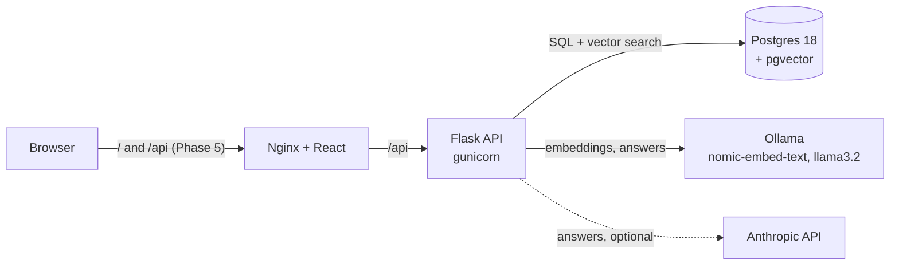
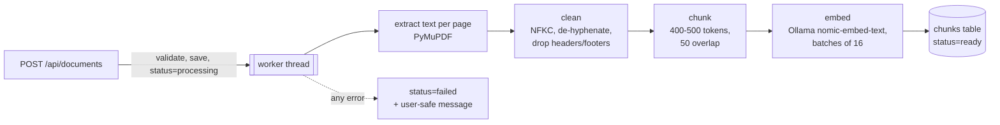
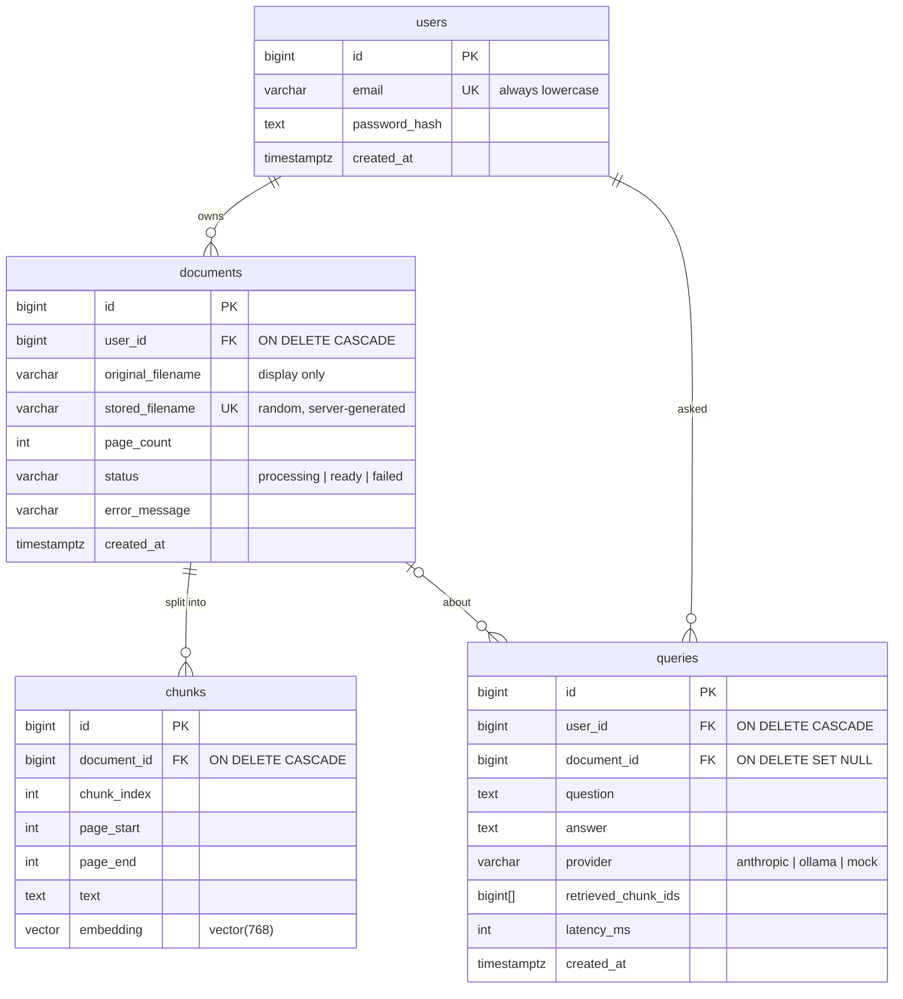

# PDFLens

Upload a lecture PDF, ask questions about it, and get answers grounded in the
document with page citations. When the document doesn't contain the answer,
PDFLens says so instead of guessing. It's a retrieval-augmented generation
(RAG) system that runs entirely on your machine with Docker Compose.

> **Status: Phase 3 of 9.** Accounts, PDF upload and the ingestion pipeline
> (extract, clean, chunk, embed, store) are in place. Question answering and
> the frontend arrive in later phases; this README grows with them.

## Architecture



| Service | Image | Host port (127.0.0.1 only) |
|---|---|---|
| postgres | `pgvector/pgvector:0.8.7-pg18-trixie` | 5433 |
| ollama | `ollama/ollama:0.40.13` | 11435 |
| backend | built from `backend/Dockerfile` (Python 3.13) | 8000 |
| frontend | Nginx serving the React build (Phase 5) | 8080 |

The host ports avoid 5432 and 11434, which a locally installed Postgres or
Ollama usually owns. Every port is bound to `127.0.0.1`, so nothing is
reachable from other machines on your network.

## Running with Docker

Prerequisites: Docker Desktop (or Docker Engine with Compose v2).

```bash
cp .env.example .env
```

Then fill in `POSTGRES_PASSWORD` (letters and digits only, and copy it into the
two `PASSWORD` placeholders in the URLs) and `SECRET_KEY`:

```bash
python -c "import secrets; print(secrets.token_urlsafe(48))"
```

Start the stack, then download the Ollama models (about 2.3 GB, only needed once;
they're kept in a Docker volume):

```bash
docker compose up --build -d
```

```bash
./scripts/pull_models.sh
```

On Windows PowerShell, use `.\scripts\pull_models.ps1` instead.

Check it's working:

```bash
curl http://127.0.0.1:8000/api/health/ready
```

```json
{"checks": {"database": "ok", "ollama": "ok"}, "status": "ok"}
```

## API

Errors always have the same shape: `{"error": {"code": "...", "message": "..."}}`.
Every `POST`/`DELETE` must send the header `X-PDFLens-CSRF: 1` (see below).

| Endpoint | Auth | Purpose |
|---|---|---|
| `GET /api/health` | – | Liveness: the process is up. Used by Docker's healthcheck. |
| `GET /api/health/ready` | – | Readiness: Postgres reachable with pgvector installed, Ollama reachable with the embedding model pulled. Returns 503 if the database is down. Ollama being down is reported but doesn't make it 503, because login and document listing still work without it. |
| `POST /api/auth/register` | – | `{"email", "password"}` → 201 `{"user"}`, logged in. 409 if the email is taken. Rate-limited. |
| `POST /api/auth/login` | – | `{"email", "password"}` → 200 `{"user"}`, logged in. 401 on any failure. Rate-limited. |
| `POST /api/auth/logout` | – | 204, clears the session cookie. |
| `GET /api/auth/me` | session | 200 `{"user"}`, or 401. |
| `POST /api/documents` | session | Multipart field `file`: a PDF up to 20 MB and 300 pages → 202 `{"document"}` with status `processing`. Rate-limited per user. |
| `GET /api/documents` | session | 200 `{"documents": [...]}`, your own only, newest first. |
| `GET /api/documents/<id>` | session | 200 `{"document"}` with `status` (`processing`, `ready` or `failed`) and `error_message`; 404 if it isn't yours. |

Trying it with curl (the cookie jar keeps the session between calls):

```bash
curl -c jar.txt -b jar.txt -H "X-PDFLens-CSRF: 1" -H "Content-Type: application/json" \
  -d '{"email": "me@example.com", "password": "correct horse battery staple"}' \
  http://127.0.0.1:8000/api/auth/register
```

```bash
curl -b jar.txt http://127.0.0.1:8000/api/auth/me
```

```bash
curl -b jar.txt -H "X-PDFLens-CSRF: 1" -F "file=@lecture.pdf" http://127.0.0.1:8000/api/documents
```

## Authentication and request security

Each measure has a comment in the code explaining the attack it stops.

| Concern | What PDFLens does | Where |
|---|---|---|
| Password storage | **Argon2id** (RFC 9106 defaults: 64 MiB, t=3, p=4), random salt per hash. Hashes made with older, weaker parameters are upgraded at the next successful login. | [passwords.py](backend/app/security/passwords.py) |
| Password policy | At least 12 characters, at most 128, no composition rules (following NIST SP 800-63B). | [auth.py](backend/app/api/auth.py) |
| Account enumeration | Login gives the same 401 message for an unknown email and a wrong password, and takes the same time: unknown emails are checked against a dummy hash. | [auth.py](backend/app/api/auth.py) |
| Sessions | Flask's signed session cookie holds only the user ID. It is `HttpOnly`, `SameSite=Lax`, `Secure` (configurable for local HTTP), and the server enforces an 8-hour expiry. | [sessions.py](backend/app/security/sessions.py) |
| CSRF | `SameSite=Lax`, plus a required custom header on every state-changing request. Other sites can't send that header without passing our CORS policy. | [csrf.py](backend/app/security/csrf.py) |
| CORS | No other origins are allowed by default (the frontend is same-origin). Only exact origins can be added, never wildcards. | [cors.py](backend/app/security/cors.py) |
| Brute force | Per-IP limits: login 5/minute and 30/hour; register 10/hour. Requests over the limit get a 429 with `Retry-After`. `X-Forwarded-For` is only trusted behind a configured proxy. | [rate_limit.py](backend/app/security/rate_limit.py) |
| Response headers | `CSP default-src 'none'`, `nosniff`, `X-Frame-Options: DENY`, `no-referrer`, `Cache-Control: no-store` on every API response. | [headers.py](backend/app/security/headers.py) |
| Logging | One line per request: route, status, duration, user ID, IP. Never bodies, query strings, cookies, passwords or emails. Failed logins are logged with a reason. | [logging_config.py](backend/app/logging_config.py) |

Known limitation: the session lives entirely in the cookie, so logging out
can't revoke a copy of the cookie stolen earlier; it stays valid until it
expires. Server-side sessions (or a per-user session counter checked on
each request) would fix that.

### Uploads

| Concern | What PDFLens does |
|---|---|
| Not a PDF | The file must start with the PDF signature `%PDF-` (magic bytes), have a `.pdf` name, and open in PyMuPDF. The client's `Content-Type` is ignored, because the client chooses it freely. Password-protected PDFs are rejected. |
| Huge uploads | Request bodies are capped at 1 MB app-wide; only the upload endpoint raises its own cap to 20 MB, and Werkzeug stops reading at the limit. Files are also capped at 300 pages. |
| Path traversal | Files are saved as `<32 random hex>.pdf`, created with `O_EXCL` (never overwrite) and mode `0600`. The client's filename is stored for display only, stripped of any directory part and control characters. |
| IDOR | Every document lookup filters on the document ID **and** the current user in one query ([access.py](backend/app/security/access.py)). Someone else's document gets the same 404 as a missing one. |
| Malicious PDFs | MuPDF is C code parsing untrusted input. PyMuPDF is kept current (2.0 includes a CVE fix), inputs are validated and capped, and the container runs as an unprivileged user. Parsing in a sandboxed subprocess would be the next step. |

## Ingestion pipeline



The code is in [backend/app/ingestion/](backend/app/ingestion/).

- **Background processing.** The upload responds with `202` immediately. One
  worker thread does the slow part, and the client polls the document's
  status. One thread is enough: PyMuPDF can only run on one thread at a time
  (it puts MuPDF in single-threaded mode, so every PyMuPDF call takes a lock),
  and Ollama on a CPU embeds one batch at a time anyway.
- **Cleaning** makes repeated text stop dominating retrieval:
  - Unicode normalisation turns ligatures into plain letters.
  - Words broken across lines are rejoined ("retriev-" + "al").
  - Lines repeated at the top or bottom of most pages (headers and footers)
    are dropped, as are bare page numbers.
- **Chunking.** Chunks are at most 500 estimated tokens (about 1.3 tokens per
  word), and end early, down to 400 tokens, if that lets them finish at a
  sentence boundary. Consecutive chunks share about 50 tokens, so a fact on a
  boundary appears whole in at least one chunk. Chunks can span pages and
  record `page_start`/`page_end` for citations.
- **Embedding** always uses Ollama's `nomic-embed-text`, whichever LLM answers
  questions, because vectors from different models can't be compared. Chunks
  get the `search_document:` prefix and questions `search_query:`, as the
  model was trained.
- **Failures.** Errors leave no partial chunks, because the whole document is
  committed in one transaction. The document shows a message that is safe to
  display, such as "No text could be found… scanned documents aren't
  supported", while the full error goes to the server log.
- **Restarts.** Jobs live in memory, so a restart loses running jobs. At
  start-up, `flask recover-ingestion` (run by `entrypoint.sh`) marks any
  document still `processing` as failed. A persistent queue would let those
  jobs resume instead.

In a manual run against the real stack, a 4-page PDF went from upload to
`ready` in about 2 seconds, giving 3 chunks (pages 1–2, 2–4, 4) with no
headers or footers left in their text.

The tests and the evaluation harness use a deterministic `FakeEmbedder`
instead of Ollama. It uses the hashing trick: each word is hashed into one of
768 slots and the vector is normalised. Texts that share words get similar
vectors, so retrieval behaves sensibly in CI without any model. It can't be
selected through configuration, so fake vectors can never end up in a real
database.

## Dev mode

Run only Postgres and Ollama in Docker, and Flask directly on your machine, so
code changes reload instantly.

```bash
docker compose up -d postgres ollama
```

```bash
cd backend
python3.13 -m venv .venv          # Windows: py -3.13 -m venv .venv
source .venv/bin/activate         # Windows: .venv\Scripts\activate
pip install -r requirements-dev.txt
alembic upgrade head
flask --app app run --debug
```

Flask, Alembic and pytest read the repo-root `.env` automatically (through
python-dotenv). The URLs there use `127.0.0.1` rather than `localhost`: on
Windows, `localhost` tries IPv6 first, and because Docker only publishes on
IPv4, every new connection would stall for seconds.

## Tests

```bash
cd backend
pytest --cov
```

- **Unit tests** (`tests/unit`) need nothing running.
- **Integration tests** (`tests/integration`) run against the `pdflens_test`
  database in the Compose Postgres (`TEST_DATABASE_URL`). They are skipped if
  that variable isn't set, and refuse to run against a database whose name
  doesn't end in `_test`, because they drop and rebuild the schema.
- Ollama is never called in tests: the app gets an httpx client whose
  `MockTransport` returns canned responses.

Run only the unit tests with `pytest -m "not integration"`.

Lint and type checks:

```bash
ruff check . && ruff format --check . && mypy
```

Current result: 180 tests passing, 99% coverage of `app/` (lines and branches).

## Environment variables

See [.env.example](.env.example) for the full, commented list.

| Variable | Used by | Purpose |
|---|---|---|
| `POSTGRES_USER`, `POSTGRES_PASSWORD`, `POSTGRES_DB` | Compose | Initialise the database |
| `POSTGRES_HOST_PORT`, `OLLAMA_HOST_PORT` | Compose | Host ports (defaults 5433, 11435) |
| `DATABASE_URL` | backend, Alembic | Dev-mode database URL (Compose sets its own) |
| `TEST_DATABASE_URL` | pytest | Integration-test database; must end in `_test` |
| `SECRET_KEY` | backend | Signs session cookies; at least 32 characters |
| `LOG_LEVEL` | backend | `DEBUG`, `INFO`, `WARNING` or `ERROR` |
| `SESSION_COOKIE_SECURE` | backend | HTTPS-only cookie; `true` unless set. `.env.example` sets `false` for local HTTP |
| `SESSION_LIFETIME_HOURS` | backend | Session expiry (default 8) |
| `CORS_ALLOWED_ORIGINS` | backend | Extra browser origins allowed to call the API; empty by default |
| `TRUSTED_PROXY_COUNT` | backend | Proxies whose `X-Forwarded-For` is trusted (0 now, 1 behind Nginx) |
| `RATE_LIMIT_LOGIN`, `RATE_LIMIT_REGISTER` | backend | Per-IP limits, e.g. `5 per minute;30 per hour` |
| `RATE_LIMIT_UPLOAD` | backend | Per-user upload limit (default `20 per hour`) |
| `UPLOAD_DIR` | backend | Where PDFs are stored in dev mode (Compose uses the `uploads` volume) |
| `OLLAMA_EMBED_TIMEOUT_SECONDS` | backend | Time limit for one embedding request (default 120) |
| `OLLAMA_BASE_URL` | backend | Dev-mode Ollama URL (Compose sets its own) |
| `OLLAMA_EMBED_MODEL` | backend, scripts | Embedding model (`nomic-embed-text`) |
| `OLLAMA_CHAT_MODEL` | scripts (backend from Phase 4) | Answering model (`llama3.2`) |

## Database schema

Defined in [backend/app/models.py](backend/app/models.py) and created by the
hand-written migration
[backend/migrations/versions/0001_initial_schema.py](backend/migrations/versions/0001_initial_schema.py).
A test (`test_models_match_migrations`) fails if the two ever drift apart.



Key decisions (each is explained in a code comment too):

- **Indexes.** `chunks.embedding` has an **HNSW** index with
  `vector_cosine_ops`. HNSW needs no training data, unlike IVFFlat, and gives
  a better speed/recall trade-off. Its operator class matches the cosine
  distance operator (`<=>`) used by retrieval. The
  `UNIQUE (document_id, chunk_index)` constraint's B-tree doubles as the
  `document_id` index.
- **Constraints.** `CHECK` constraints are used instead of Postgres `ENUM`
  types, because adding a status later is then a one-line migration. Other
  constraints enforce lowercase emails, valid page ranges and the 768-dimension
  vector.
- **Audit trail.** `queries.document_id` is `ON DELETE SET NULL`, so audit
  records outlive deleted documents.
- **No app imports in migrations.** Migrations never import app code, so
  they keep producing the same schema as the code evolves.

## Troubleshooting

- **`docker pull` fails with `EOF` from `production.cloudfront.docker.com`.**
  This is a Docker Desktop proxy issue, not a project issue; restarting Docker
  Desktop often fixes it. As a workaround, pull the identical image from
  Google's Docker Hub mirror and retag it, for example:
  `docker pull mirror.gcr.io/pgvector/pgvector:0.8.7-pg18-trixie` then
  `docker tag mirror.gcr.io/pgvector/pgvector:0.8.7-pg18-trixie pgvector/pgvector:0.8.7-pg18-trixie`.
- **The `pdflens_test` database doesn't exist.** The init script only runs
  when the Postgres volume is first created. Either run
  `docker compose exec postgres createdb -U pdflens pdflens_test`, or recreate
  the volume with `docker compose down -v` (this deletes all data).

## Project structure

```
backend/        Flask API, SQLAlchemy models, Alembic migrations, pytest suite
docker/         Postgres init script (creates the test database)
scripts/        pull_models.sh / .ps1, check_embedding_dim.py
frontend/       React + TypeScript (Phase 5)
eval/           Evaluation harness (Phase 6)
.github/        CI workflow (Phase 8)
```
